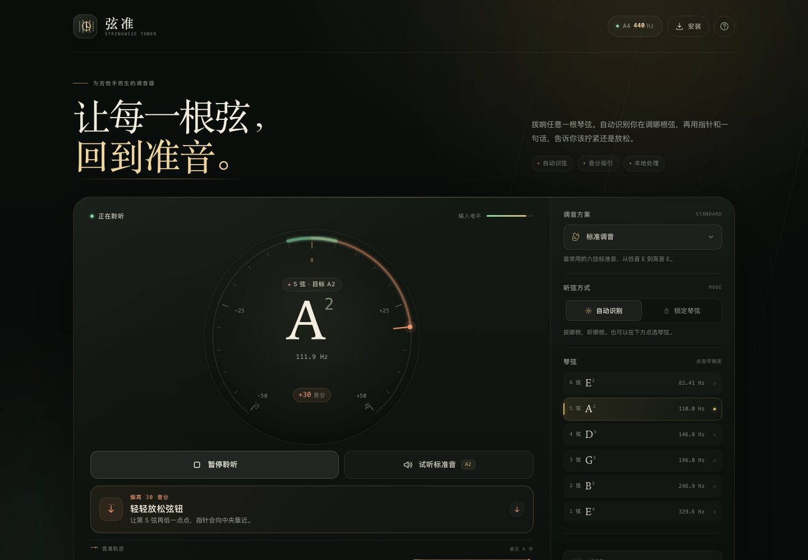
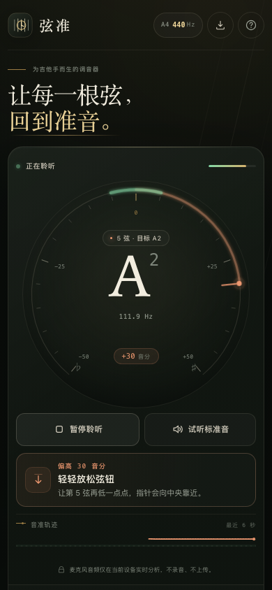

# 弦准 · Stringwise Tuner

一个为吉他手设计的实时调音器，所有处理都在浏览器本地完成。手机、平板、电脑用同一个 HTTPS 地址打开即可，也可以安装成 PWA，像原生应用一样从桌面或主屏幕启动。

**在线使用：** <https://shuanmiangui.github.io/xianzhun-tuner/>（GitHub Pages）



<p align="center">
  
</p>

## 它有什么

- **麦克风实时调音**：基于 YIN 音高检测，并对周期估计做抛物线插值，适合吉他 E2–E4 以及七弦的 B1。
- **自动识别琴弦**：拨哪根，自动落到最近的目标弦；也可以手动锁定某一根弦。
- **明确的调节指引**：表盘、音分数值，加上「偏低 → 拧紧 / 偏高 → 放松」的文字提示。差得多时会提示约几个半音。
- **六种常用调弦**：标准、Drop D、降半音、开放 G、DADGAD、七弦标准。
- **A4 标准音校准**：415–466 Hz 可调，目标音高会同步更新。
- **参考音试听**：在本地合成拨弦音色的标准音，没有麦克风也能对音。
- **输入设备选择**：支持外接麦克风或声卡，切换后立即生效。
- **完整的跨设备界面**：桌面双栏、平板自适应、手机单栏。支持安全区、横屏滚动、触控尺寸、键盘焦点、屏幕阅读器播报和减少动效偏好。
- **PWA / 离线**：可安装到桌面或主屏幕，首次加载后断网也能打开。

## 快速开始

项目是纯静态站点，无需安装依赖、无需构建。

### 在电脑上本地运行

在项目目录中执行：

```bash
python3 -m http.server 8000
```

然后打开 [http://localhost:8000](http://localhost:8000)，点击「开启麦克风」。

> `localhost` 被浏览器视为安全上下文，所以本机可以直接使用麦克风。

### 在手机或平板上使用

手机浏览器只会在 **HTTPS** 页面（或本机 localhost）中开放麦克风。因此把整个文件夹部署到任意静态托管即可，不需要服务器代码：

**Netlify Drop（最快）**

1. 打开 <https://app.netlify.com/drop>。
2. 把整个项目文件夹拖入页面。
3. 得到 HTTPS 地址后，在手机、平板、电脑上分别打开。

**Vercel / Cloudflare Pages**

- 新建一个静态项目，直接上传或连接这个文件夹。
- 不需要 Build Command，输出目录就是项目根目录。

**GitHub Pages**

1. 新建仓库，把所有文件上传到仓库根目录。
2. Settings → Pages → Deploy from a branch → `main` / root。
3. 用生成的 HTTPS 地址访问。项目的相对路径可直接在仓库子路径下工作。

> 重要：不要用 `http://192.168.x.x` 这类局域网 HTTP 地址访问手机端，浏览器会禁止麦克风。需要 HTTPS（或隧道工具提供的 HTTPS 地址）。

### 安装到主屏幕

- **iPhone / iPad**：Safari 打开 HTTPS 地址 → 分享 → 添加到主屏幕。
- **Android**：Chrome 打开 → 右上角菜单 → 安装应用 / 添加到主屏幕。
- **电脑**：Chrome / Edge 地址栏右侧的安装图标，或页面右上角的「安装」按钮。

首次加载后资源会进入离线缓存；之后即使断网也能启动应用。

## 怎么调

1. 点击「开启麦克风」并允许权限。
2. 保持环境相对安静，一次只拨一根弦。木吉他靠近音孔，电吉他靠近音箱或使用音频接口。
3. 看表盘和下方提示：
   - 指针在中央左侧、音分为负：**音偏低，轻轻拧紧弦钮**。
   - 指针在中央右侧、音分为正：**音偏高，轻轻放松弦钮**。
   - 进入中央绿色区域（±5 音分）：「准了」。
4. 可以点侧栏的琴弦锁定某一根弦，也可以点「试听标准音」用耳朵对比。

> 自动模式永远根据听到的音高选择最近的琴弦。如果你正在调一根已经偏离很多的弦，建议先手动锁定目标弦。

## 文件结构

```text
吉他调音器/
├── index.html                 # 页面结构和所有界面文案
├── styles.css                 # 视觉系统、响应式、对话框、动效
├── app.js                     # 麦克风采集、调音 UI、设置、参考音、PWA 交互
├── pitch.js                   # 独立的 YIN 音高检测器（可单独用于 Node 测试）
├── manifest.webmanifest       # PWA 安装信息
├── sw.js                      # 离线缓存与更新
├── assets/
│   ├── icons/                 # SVG / PNG / maskable / Apple 图标
│   └── screenshots/           # README 与安装说明使用的预览图
└── README.md
```

## 技术说明

- **音高检测**：`pitch.js` 使用 YIN 累积均值归一化差值函数，在约 22 kHz 工作采样率上做检测，再做抛物线插值。检测器运行在 `AnalyserNode` 提供的时域数据上，约每 52 ms 分析一帧。
- **显示平滑**：对最近 210 ms 的频率取中位数，再做适度指数平滑，减少指针抖动但不牺牲调音响应。
- **音频输入**：优先关闭浏览器的回声消除、降噪和自动增益，以获得更准确的基频；如果设备拒绝这些约束，会自动退回到普通采集。
- **自动识弦**：将当前音高与预设中每根弦的目标频率比较，选择音分距离最小的一根。
- **标准音**：用 Karplus–Strong 拨弦合成生成参考音，不加载外部音频文件，可离线工作。
- **离线更新**：`sw.js` 采用缓存优先、后台刷新的策略。发布新版本时请同步修改 `CACHE_NAME`，例如 `xianzhun-v1.0.1`。

## 隐私

麦克风音频只通过浏览器的 Web Audio API 在当前设备内实时分析：

- 不录音
- 不上传
- 不写入音频数据
- 页面没有任何统计、广告或第三方请求

唯一保存在 `localStorage` 里的数据是你的界面设置：A4、调弦方案、模式、触感开关和选择的输入设备。

## 已验证

- Chromium 中通过模拟麦克风输入，逐根验证 E2 / A2 / D3 / G3 / B3 / E4 的识别、自动切弦、音分与自动校准。
- WebKit（Safari 内核）中验证页面渲染、Web Audio 麦克风链路、参考音、对话框和离线缓存。
- PWA manifest 校验通过，Chrome 的安装性检查无错误。
- 断网后重新载入仍能打开应用。
- 320 / 360 / 390 / 430 / 768 / 834 / 1024 / 1280 / 1440 / 1920 宽度下无横向溢出，首屏操作按钮可用。

## 已知限制

- 这是**单音**调音器：请一次拨一根弦，不要扫和弦。
- 浏览器内嵌浏览器（如聊天软件内置浏览器）可能禁用麦克风；遇到时请用系统浏览器打开。
- 极嘈杂、强低频驻波或强电流声环境会影响所有麦克风调音器的判断。
- 无线耳机麦克风的延迟和频响可能让读数变慢或变窄，建议使用设备自身麦克风或外接声卡。
